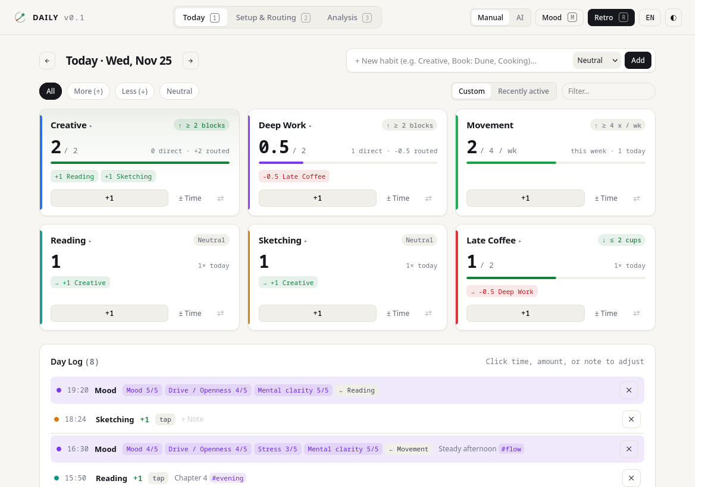
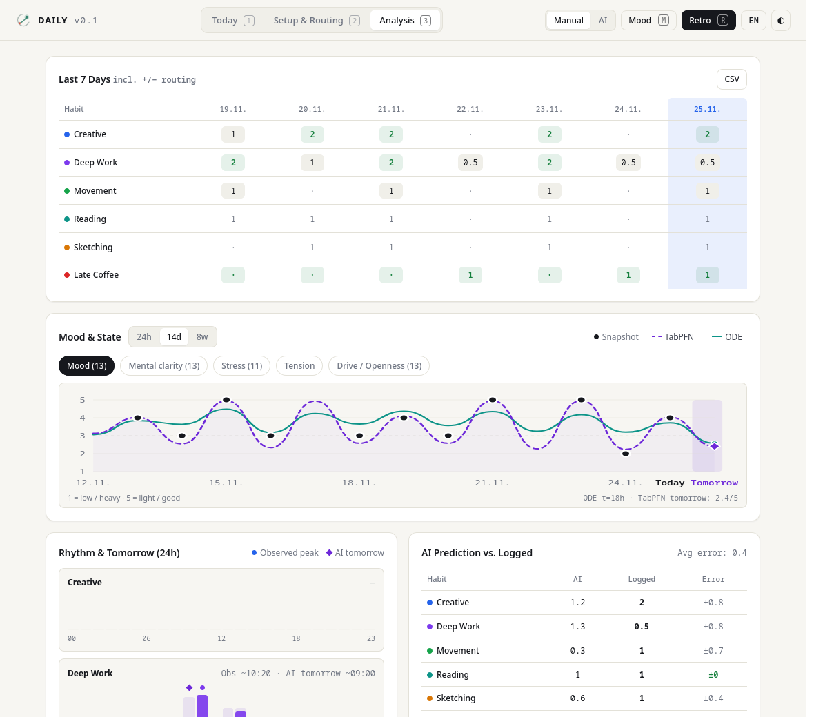

#  Daily — Local-First Signed-Graph Habit Tracker, Liquid ODE & TabPFN v2

[](https://daily.aethelburg.network)
[](LICENSE)

**Zero Presets. Zero Cloud Accounts. Zero Tracking.**  
A calm, sharp scalpel for your habits and daily rhythms — works **100% locally in any browser/phone (PWA)** or **self-hosted with local TabPFN v2 AI**, with built-in **AES-256-GCM end-to-end encrypted multi-device sync** and bilingual **EN / DE** UI.

- **Try instantly / install on your phone:** **[https://daily.aethelburg.network](https://daily.aethelburg.network)**  
  *(iOS Safari/Firefox: Share → Add to Home Screen · Android Chrome: Install App — works offline out of the box.)*
- **Prebuilt Desktop & Android Downloads:** **[GitHub Releases](https://github.com/aethelnet/Daily/releases/latest)** *(self-contained `.deb`, `.rpm`, Windows `.exe`, macOS, Android `.apk`, and Offline Web `.zip` — zero Python or package installs required.)*

<p align="center">
  
</p>
<p align="center">
  
</p>

---

## Core Features

- **Zero presets, open direction or concrete targets:** Create **More (`↑`)**, **Less (`↓`)**, or **Neutral** tracks — with *optional* numeric targets measured **per day**, **per week (Mon–Sun)**, or **per month** (no guilt quotas, no awkward `0.3/day` fractions).
- **Cycle-safe `+` / `−` live graph routing:** Route any habit onto any other with arbitrary signed weights (e.g., `Reading +1 → Creative`, `Late Coffee −0.5 → Deep Work`). Tap a card on **Today** to expand all connected cards right underneath (**Multi-Toggle**).
- **Retro Check-in (`Key R`):** No stopwatch pressure — distribute what happened over the last 1–4 hours in seconds.
- **Mood & State Snapshots (`Key M` · 0 nags):** 5 optional orthogonal EMA axes (*Mood, Mental clarity, Stress, Tension, Drive / Openness*) + custom axes + optional habit cause chips. Unrated days enter TabPFN as true `NaN`s.
- **Structured `#tags` in notes for TabPFN:** Free-text notes stay human context for you — any `#tag` (e.g. `#flow`, `#travel`) used on `≥ 2` days is automatically parsed as a clean binary feature column for TabPFN v2 and CSV export (filtering one-off typos).
- **Dual-Engine State Curve (`24h | 14d | 8w` + mouse-wheel zoom):**
  - **TabPFN v2** (local Apache-2.0 tabular foundation model on CPU, XGBoost fallback) predicts tomorrow's 24h rhythm, tracks out-of-sample prediction vs. actual error from Day 1, discovers time-window-specific AI assumptions, and optionally refines live routing (`Manual | AI`).
  - **Continuous-Time Liquid Relaxation ODE ("Clockwork")** ($\dot{s} = -(s - s_0)/\tau + \sum_i w_i u_i(t)$, exact analytical Ridge fit with LOO $\tau$-selection) runs both in Python and directly in the browser — toggle either curve cleanly in the chart legend.
- **Calm reminders & quiet `+45 min` follow-up:** Optional fixed time anchors per weekday (Linux `notify-send` + Mobile/iOS Home-Screen Web Notifications via Service Worker), plus a silent check-in 45 minutes later *only* if nothing was logged yet.
- **Clean long-term hygiene:** Atomic **Habit Merge** (transfer history without losing data), 1-click **Archive** (history preserved for rollups & AI), **JSON Backup/Restore**, and **CSV feature export**. *(Roadmap: optional write-only Obsidian Daily Notes Markdown export — strictly one-way write so private journal prose is never read back.)*

---

## Multi-Device Sync (PC + Phone + Tablet) — How to Set It Up

You never have to run hotspots or remember which device was online last. Daily uses **conflict-free CRDT merging** (every event and snapshot has a `client_uuid`, `updated_at`, and delete tombstone): log offline on your phone, tablet, and PC in any order — they merge cleanly without overwriting each other.

### Option A: Encrypted Sync Across Mobile Data & Wi-Fi (Recommended)

Everything is encrypted **on your device with AES-256-GCM** (random 96-bit IV per push) *before* leaving the browser or PC. The storage host only ever sees opaque ciphertext — no Daily server exists.

1. Open **Setup & Routing → Device Sync & Backup** (best done on your PC first so a scannable QR code is generated, or directly on `daily.aethelburg.network`).
2. **Step 1 — Pick a blind mailbox:**
   - **WebDAV / Nextcloud (zero GitHub):** Paste a file URL in any WebDAV folder (e.g., Nextcloud, Mailbox.org, Hetzner Storage Box: `https://.../daily-vault.json`) plus your `Basic` / `Bearer` Authorization header → click **Start sync**.
   - **Private GitHub Gist (free, 0 servers):** Click **Create token →** (pre-selects **only** the `gist` scope — zero access to repos, SSH keys, or account settings; works equally well with a **separate throwaway GitHub account**). Paste the token → click **Start sync**.
3. **Step 2 — Pair phone & tablet (no typing):**
   - Scan the QR code (or open the pairing link) on your phone/tablet.
   - The 256-bit key lives only in the URL `#e2ee=` hash fragment (never sent to HTTP servers or logged in access logs).
   - Add `daily.aethelburg.network` to your Home Screen — it caches offline via Service Worker and auto-syncs whenever you log, resume the app, or come back online.

#### Honest Threat Model (What Is & Isn't Protected)
- **Protected:** Your habit logs, notes, and mood snapshots are encrypted client-side with AES-256-GCM before upload. Neither GitHub nor your WebDAV host can read them. The site loads **zero** third-party scripts, CDNs, or Google Fonts.
- **Trade-off to know:** In browser PWA mode, the 256-bit sync key and mailbox token are stored in your browser's `localStorage` so background sync works without re-entering a password. Anyone who captures a screenshot of your pairing QR link (or a malicious browser extension with access to all websites) could read `localStorage`. If you want zero link to your primary GitHub account, use a dedicated throwaway Gist account or your own WebDAV folder.

### Option B: Home Wi-Fi / Self-Hosted PC Only (Zero Internet / Zero Accounts)

> **Note on running a server on a phone:** iOS suspends background servers within ~30s and mobile carriers place phones behind CGNAT (blocking incoming ports). On phones, Daily runs locally in the browser/WebView via `local-engine.js` instead. If you want a Python/TabPFN server, run it on your PC/laptop or home Raspberry Pi.

#### Prebuilt Packages (Zero Python Needed)
Download the latest release from **[GitHub Releases](https://github.com/aethelnet/Daily/releases/latest)**:
- **Ubuntu / Debian / Mint:** `sudo apt install ./daily_0.1.0_amd64.deb`
- **Fedora / Bazzite / openSUSE:** `sudo dnf install ./daily-0.1.0-1.x86_64.rpm`
- **Windows / macOS / Portable Linux:** Extract and run `daily` (opens `http://127.0.0.1:8090` automatically).
- **Flathub / Flatpak:** Packaging metadata & manifest live in [`packaging/linux/`](packaging/linux) and [`packaging/flatpak/`](packaging/flatpak).

#### From Source (with Optional Full TabPFN v2)
```bash
git clone https://github.com/aethelnet/Daily.git
cd Daily
python3 -m venv .venv
.venv/bin/pip install -r requirements.txt          # core + lean CPU XGBoost fallback
# Optional upgrade for full local TabPFN v2 foundation model:
# .venv/bin/pip install -r requirements-ai.txt
./start.sh
# Local browser: http://127.0.0.1:8090
```

- SQLite WAL database lives at `~/.local/share/daily/daily.db`.
- To expose Daily on your **home Wi-Fi only**:
  ```bash
  DAILY_HOST=0.0.0.0 ./start.sh
  ```
  External devices are automatically protected by a local `X-Daily-Token` (constant-time check + rate limiter). Open **Setup & Routing → Home Wi-Fi only** to get your local pairing QR code.
- **Want your home PC server on 5G without Tailscale or third parties?** Enable **WireGuard VPN** on your home router (e.g., native WireGuard in a Fritz!Box) — your phone connects straight into your home LAN with zero cloud middlemen.

---

## Native Mobile Wrapper (Android & iOS)

Capacitor 7 wrapper projects live in [`mobile/`](mobile/README.md):

```bash
cd mobile
npm install
npm run sync:web && npx cap copy
```

## License

[MIT](LICENSE) — Niklas Herlyn.
